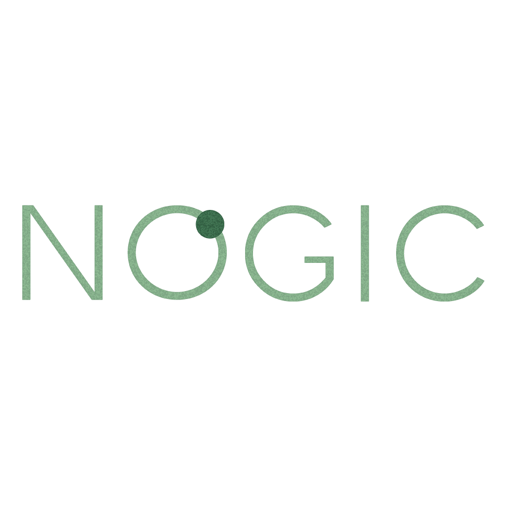
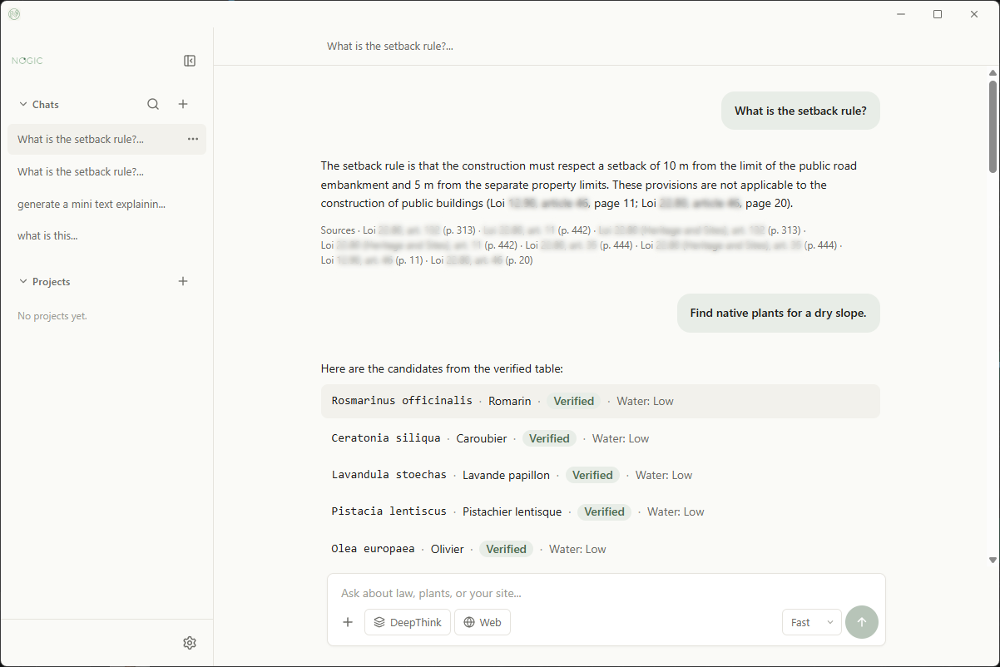
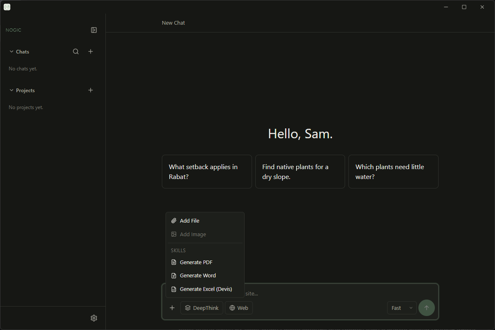
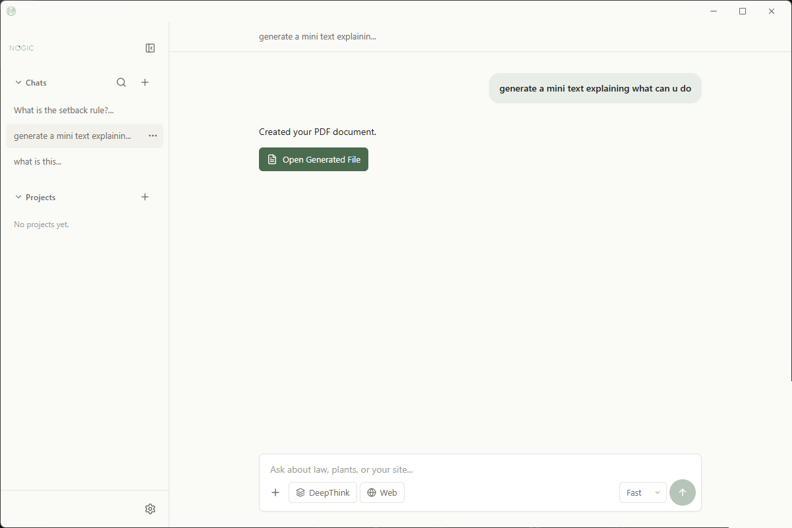
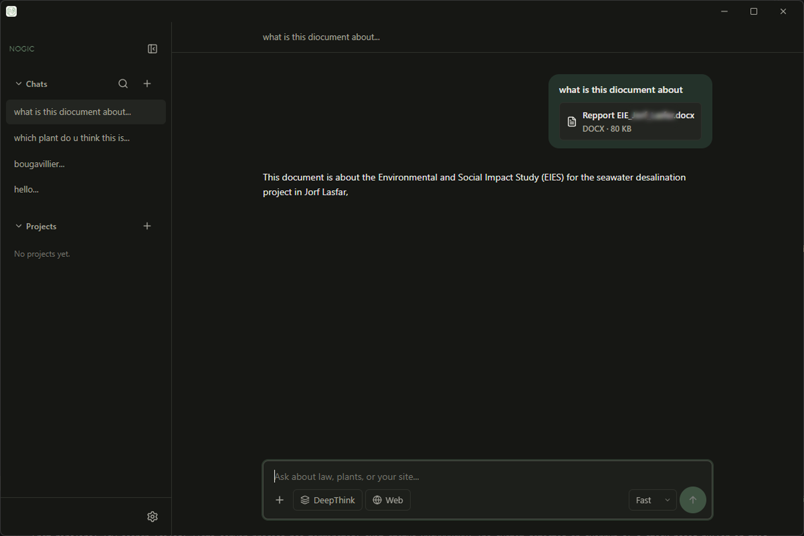
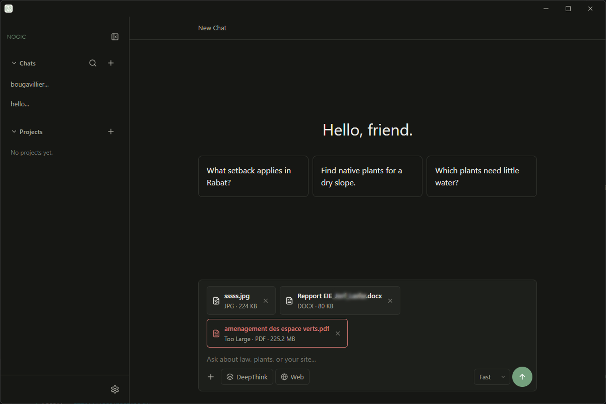
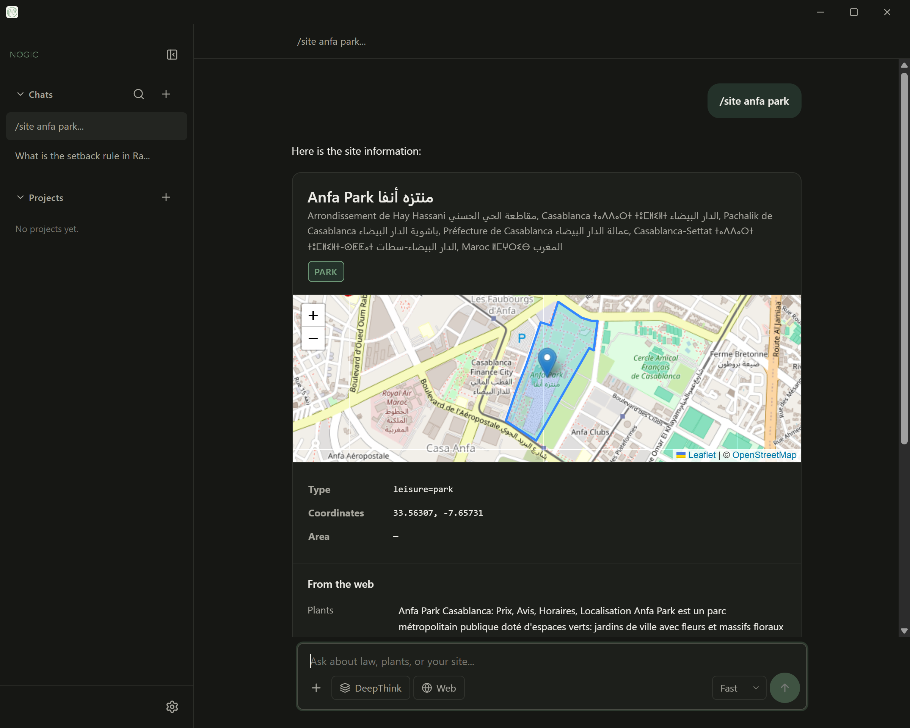

# <p align="center"></p>

<p align="center">
  <a href="LICENSE"></a>
  
  
</p>

## The Pitch

Nogic is a local-first AI colleague for landscape architecture. It runs entirely on your machine, using local LLMs via Ollama, and answers questions about landscape law and plants by citing its sources—never from memory.

## Screenshots

### Main chat



### The `+` menu (If the LLM doesn't support vision = can't attach images to the app)



### Generated document (PDF, WORD, EXCEL)



### Reading a DOCX (Same as other file types)



### Attachments (Attached files limit 25 MB)



### OSM site analysis (Other information are gathered from the WEB)



## Key Features

- **Honest RAG** : Law and Plant databases with source citations.
- **Site Analysis** : OpenStreetMap integration via `/site`.
- **Vision & Document Processing** : Upload images, PDFs, Word, and Excel files for the AI to read.
- **AI Skills** : Generate structured PDF, Word, and Excel documents.
- **Multi-language** : UI support for EN, FR, AR (RTL), ES, and PT.

## Why Nogic? (Built on Honesty)

Nogic follows one rule: **cite or refuse**. If the local law or plant data cannot support an answer, Nogic says so instead of filling the gap with a confident guess. The goal is not to sound intelligent; it is to be useful when the source matters.

It was **vibe-coded by a non-programmer using AI agents**—and that is a badge of honor. The project is an experiment in making careful, transparent software with the tools available now.

## Attribution & Special Thanks

This app would not be possible without the incredible open-source community. Special thanks to:

- **[Ollama](https://ollama.com/)** : The local LLM runtime that powers all inference.
- **[Tesseract OCR](https://github.com/tesseract-ocr/tesseract)** : (Apache 2.0) Used for extracting text from scanned PDFs. Nogic distributes a portable version of Tesseract to ensure zero-configuration for the user.
- **Document Generation** : [PyMuPDF](https://pymupdf.readthedocs.io/), [ReportLab](https://www.reportlab.com/), [python-docx](https://python-docx.readthedocs.io/), and [openpyxl](https://openpyxl.readthedocs.io/).
- **[OpenStreetMap](https://www.openstreetmap.org/) & [Nominatim](https://nominatim.org/)** : For geocoding and site map generation via the `/site` command.
- **[Tauri](https://tauri.app/)**, **[React](https://react.dev/)**, and **[Tailwind CSS](https://tailwindcss.com/)** : The foundation of the desktop app.
- The AI agents that helped build this: **Claude**, **ChatGPT**, **GitHub-Copilot**, **Cline**, **OpenCode**, and **Tabbit**.

*Disclaimer: Nogic may bundle or utilize other open-source tools and libraries that carry their own respective licenses. Please refer to the `docs/LICENSES.md` for more information.*

## Getting Started

1. Download the latest Nogic `.exe` installer from the [GitHub Releases](https://github.com/nogic-app/nogic/releases) page.
2. Install [Ollama](https://ollama.com/download/windows) and download a model, for example:

   ```powershell
   ollama pull gemma3:4b
   ```

3. Run Nogic from the Start menu. It will connect to Ollama locally.

## The SmartScreen Note

Because Nogic is an independent, open-source project, the Windows installer is not code-signed. Windows SmartScreen will flag it. This is normal for indie software; you can safely click “More info” → “Run anyway”.

## License

[](https://github.com/nogic-app/nogic?tab=GPL-3.0-1-ov-file)

Nogic is released under the GNU General Public License v3.0. See the [License Overview](https://github.com/nogic-app/nogic?tab=GPL-3.0-1-ov-file) for permissions and limitations.